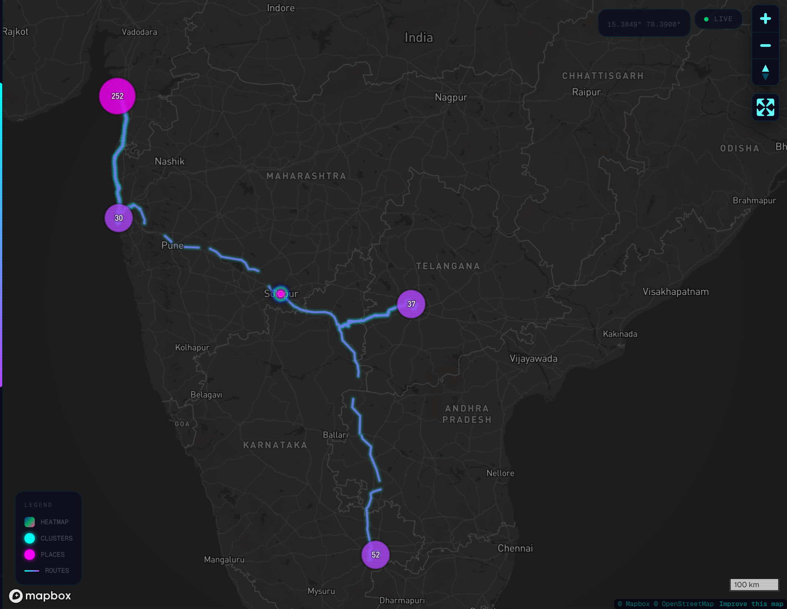
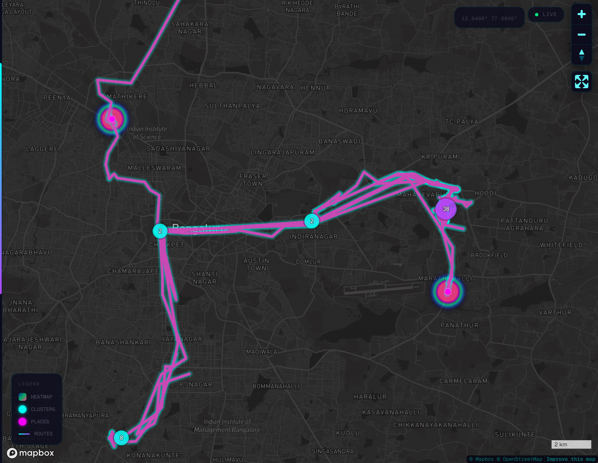
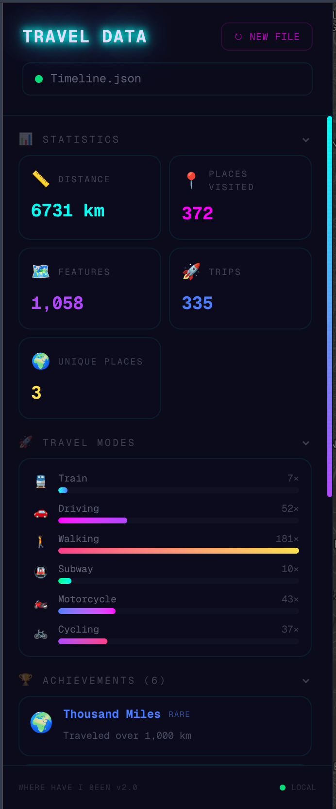
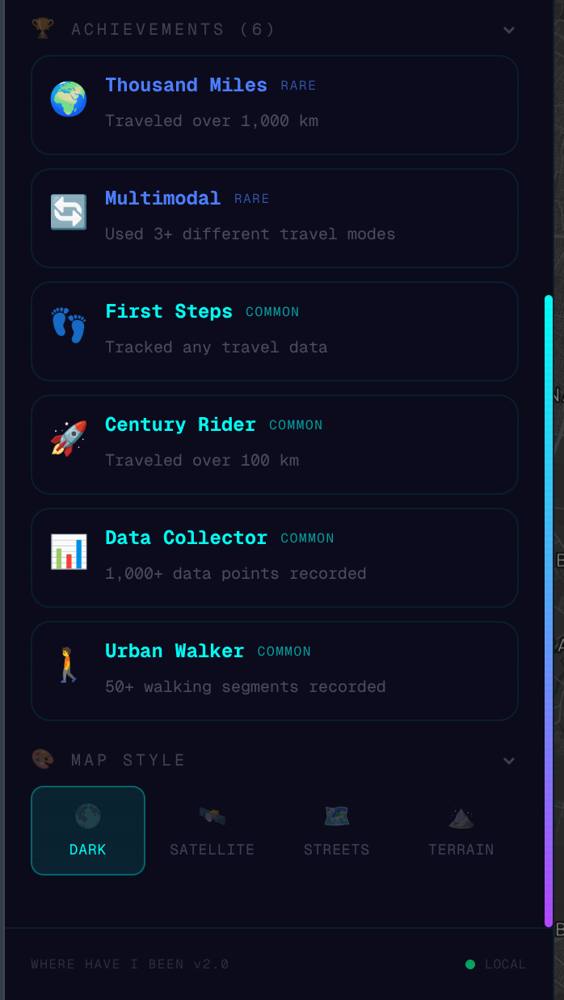

# 🌍 WHERE HAVE I BEEN

_Honestly, this was just a really fun project! I vibe-coded the whole thing because I just wanted to make an app that tracks all my footprints all over the world._

A stunning, cyberpunk-themed travel visualization app that transforms your location history into an interactive map experience. Upload your travel data files and watch your journeys come alive with heatmaps, route animations, and rich statistics.

**🚀 Live Demo:** [https://where-have-i-been.vercel.app](https://where-have-i-been.vercel.app)

**Local history processing** — uploaded files are read in your browser and are never uploaded to a server. The basemap uses Mapbox network requests.

---

## 📸 Screenshots







---

## ✨ Features

- **Multi-format Support** — GPX, KML, GeoJSON, Google Timeline JSON, Google Takeout Semantic Location History, Google Records JSON
- **Timeline Playback** — progressively reveal footprints with a time slider, play/pause, playback speed, and optional gap skipping
- **Date Exploration** — filter by a date range, jump to a month/year, or open a day diary
- **Traceable Statistics** — click a statistic to see how it is calculated; missing information is shown as unavailable
- **Interactive Heatmap** — See where you spend the most time at a glance
- **Route Visualization** — Gradient-colored travel routes with glow effects
- **Clustered Points** — Intelligently grouped location markers that expand on zoom
- **3D Terrain** — Tilt the map to see terrain elevation with atmospheric sky
- **4 Map Styles** — Dark, Satellite, Streets, Terrain — switch anytime
- **Travel Statistics** — Distance, places visited, trips, duration, elevation, speed
- **Travel Mode Breakdown** — Visual chart showing your transport modes (driving, walking, cycling, etc.)
- **Achievement System** — Earn badges for travel milestones (distance, places, elevation, multimodal travel)
- **Rich Popups** — Click any point to see visit details, duration, and timestamps
- **Cyberpunk Aesthetic** — Neon glows, scanlines, animated particles, glassmorphism
- **Fully Responsive** — Works on desktop and mobile with collapsible sidebar
- **Keyboard Shortcuts** — Press `Esc` to toggle sidebar

## 🚀 Getting Started

### Prerequisites

- Node.js 18+
- A [Mapbox](https://mapbox.com) access token (free tier is sufficient)

### Installation

```bash
# Clone the repository
git clone https://github.com/your-username/where-have-i-been.git
cd where-have-i-been

# Install dependencies
npm install

# Create environment file
cp .env.example .env.local
# Edit .env.local and add your Mapbox token

# Start development server
npm run dev
```

### Environment Variables

| Variable                          | Description                 | Required |
| --------------------------------- | --------------------------- | -------- |
| `NEXT_PUBLIC_MAPBOX_ACCESS_TOKEN` | Your Mapbox GL access token | ✅       |

> **Note:** Keep your token private and rotate it immediately if you ever accidentally commit it.

### Building for Production

```bash
npm run build
npm start
```

## 📁 Supported File Formats

| Format              | Extension  | Description                                               |
| ------------------- | ---------- | --------------------------------------------------------- |
| **GPX**             | `.gpx`     | GPS Exchange Format (Strava, Garmin, etc.)                |
| **KML**             | `.kml`     | Google Earth / Google My Maps                             |
| **GeoJSON**         | `.geojson` | Standard geographic JSON                                  |
| **Google Timeline** | `.json`    | Modern Google Timeline export (2024+, `semanticSegments`) |
| **Google Takeout**  | `.json`    | Legacy Semantic Location History (`timelineObjects`)      |
| **Google Records**  | `.json`    | Raw location records (`locations` array)                  |

## 📍 Example: Export Google Timeline from your phone

Here’s one simple way to grab your location history and upload it:

1. On your phone, open **Google Maps** → tap your profile photo → **Your Timeline**.
2. Tap the **⋮** menu → **Settings & privacy** → **Export Timeline data**.
3. Choose a date range, then export the file (you’ll get a `.json`).
4. Upload that file directly into this app’s drop zone.

> The export typically contains `semanticSegments`, which the app supports out of the box.

## 🏗️ Architecture

```
app/
├── page.js                 # Main app entry with state management
├── layout.js               # Root layout with SEO meta tags
├── globals.css             # Design system (cyberpunk theme, animations)
├── components/
│   ├── JourneyExplorer.js  # Date range, playback, and synchronized map/statistics
│   ├── Timeline.js         # Time slider, activity density, and playback controls
│   ├── DropZone.js         # File upload with particle animation
│   ├── MapView.js          # Mapbox GL map with all layers & interactions
│   ├── Sidebar.js          # Stats, achievements, travel modes, map styles
│   └── ErrorBoundary.js    # Graceful crash recovery
└── utils/
    ├── journey.js          # Normalized records, temporal clipping, and statistics
    ├── fileParser.js       # Multi-format parser (GPX, KML, GeoJSON, Google)
    └── achievements.js     # Travel achievement/badge system
```

## Exploring time and understanding the numbers

Choose **Try a sample journey** to explore a synthetic multi-day history without importing personal data. After importing your own file, select dates or a day in the sidebar. The slider represents elapsed time within that range. Dragging backward hides later footprints; playback reveals them progressively without moving the camera. **Fit journey** explicitly frames the selected range.

- Times and calendar dates use the browser's timezone, displayed beside the date filters.
- Point timestamps reveal routes incrementally. Routes with only start/end times appear when complete; partial route positions and reported distance totals are not invented.
- Undated records appear in the full-history view and are excluded during date filtering and playback.
- Separate paths never acquire connecting distance. Timed gaps over 30 minutes split a track. Raw isolated points and polygon outlines do not imply travelled distance.
- Visits and unique places are separate. Place IDs identify distinct places, with exact coordinates rounded to six decimals as a fallback.
- Google activity distance is excluded when it overlaps a timed recorded route, to avoid counting the same travel twice. This conservative policy may omit a reported activity's uncovered portion.
- Recorded travel time combines route/activity intervals and excludes the gaps between them. It is not a claim of moving time or complete location coverage.

Run the data regression suite with `npm test`, lint with `npm run lint`, and verify production compilation with `npm run build`.

## 🛡️ Privacy

This app is designed with privacy as a core principle:

- **No server uploads** — All file parsing happens client-side in your browser
- **No analytics** — No tracking scripts, no cookies, no data collection
- **Map requests** — Mapbox provides styles, terrain, fonts, and tiles. Those requests can reveal the map area being viewed; uploaded history itself is not sent to Mapbox.
- **Open source** — Inspect the code yourself

## 📄 License

MIT

---

Built with [Next.js](https://nextjs.org), [Mapbox GL JS](https://mapbox.com), and a love for travel 🌏
