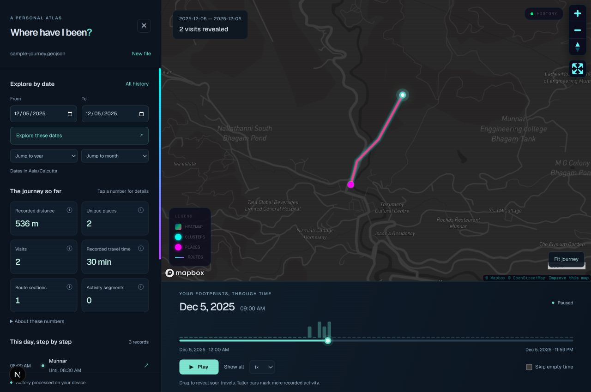

# 🌍 Where Have I Been

Your travel history, mapped out. Explore the places you visited, revisit a particular day, and watch your footprints appear through time.

**[Open the app →](https://where-have-i-been.vercel.app)**

No account or installation needed. Choose **Try a sample journey** to explore the features before opening your own history.

## Watch your world grow

An entire location history can be overwhelming. The timeline lets you explore it a little at a time:

- **Drag through time.** Move forward to reveal later footprints, or backward to revisit an earlier moment.
- **Play your journey.** Adjust playback speed and optionally skip stretches with no recorded activity.
- **Focus on a trip.** Choose a date range or jump straight to a month or year. The map and statistics update together.
- **Revisit a day.** Open its diary to see visits and activities in order. Select an entry to jump to that moment.

The camera stays steady while you scrub. Use **Fit journey** whenever you want to frame the selected range again.

## More than a trail on a map

Explore recorded locations with heatmaps, clustered markers, and routes. Switch between Dark, Satellite, Streets, and Terrain views, or tilt the map to see the landscape in 3D.

The sidebar brings the details together:

- Recorded distance and travel time.
- Visits, unique places, route sections, and activity segments.
- Transport modes when your export includes them.
- Travel milestones based on the available data.

Click a statistic to see how it is calculated. Separate tracks are not joined to invent extra distance, returning to a place counts as another visit, and activity segments are distinguished from whole trips. Values the file cannot support appear as **Unavailable**.

Works on desktop and mobile. Press **Esc** to open or close the sidebar.

## Bring your history

Open the [live app](https://where-have-i-been.vercel.app), then choose a file or drag it onto the page. Your file is read locally in the browser.

| Your data | File type |
| --- | --- |
| Google Maps Timeline export | `.json` with `semanticSegments` |
| Older Google Takeout Semantic Location History | `.json` with `timelineObjects` |
| Google location records | `.json` with a `locations` array |
| GPS tracks, such as hiking or cycling recordings | `.gpx` |
| Google Earth or other KML exports | `.kml` |
| Geographic features and routes | `.geojson` or GeoJSON-formatted `.json` |

For Google Timeline, export the history from your phone and open the resulting JSON file in the app. See [Google's Timeline help](https://support.google.com/maps/answer/6258979) for export instructions for your device.

Importing a file does not connect your Google account or enable automatic syncing. To explore a newer export, choose **New file**.

## Your history stays on your device

Your imported history is parsed and explored in your browser. The app does not upload the file, require an account, or save your history in a server database. Refreshing the page clears the imported session.

**The map still uses the internet.** Mapbox supplies map styles, tiles, fonts, and terrain. Those requests can reveal the area being viewed; the imported history itself is not sent to Mapbox.

## A few things to know

- **Playback depends on timestamps.** Routes with point-by-point times appear progressively. Routes with only start and end times appear when complete, rather than showing an invented position along the way.
- **Undated data is still viewable.** It appears in the full-history view, but is hidden during date filtering and playback. Files with no timestamps can be explored as a complete map.
- **Dates use your browser's timezone.** The timezone is shown beside the date controls.
- **The map reflects recorded coverage.** Gaps in an export remain gaps. Raw location points alone do not establish a continuous route, and recorded travel time is not necessarily time spent moving.

---

Built with [Next.js](https://nextjs.org), [React](https://react.dev), [Mapbox GL JS](https://www.mapbox.com/mapbox-gljs), and [Tailwind CSS](https://tailwindcss.com).

MIT license.
